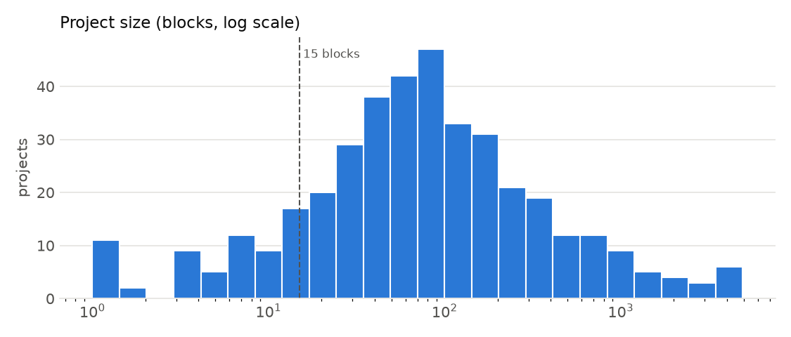
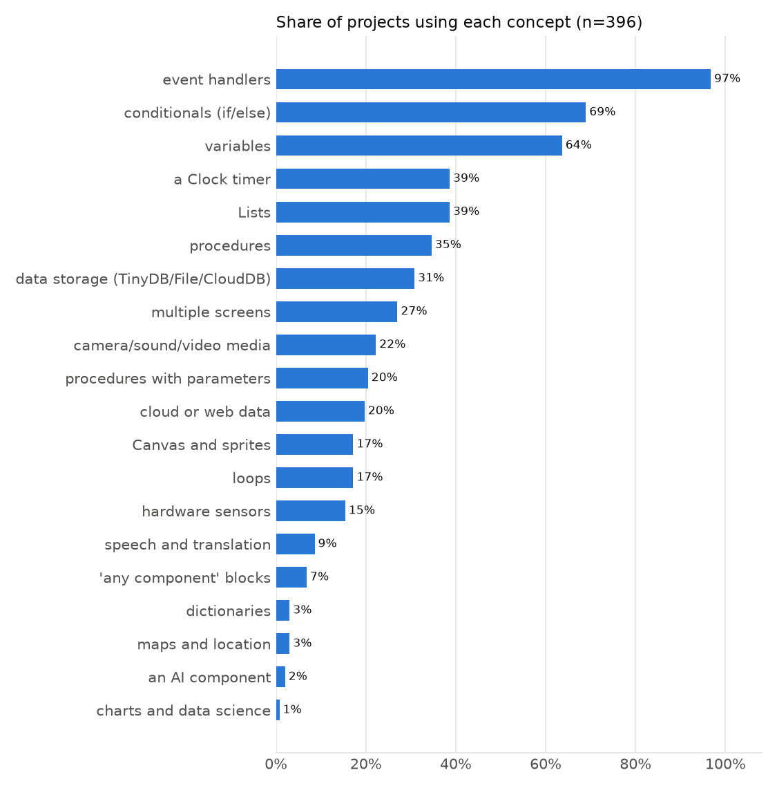
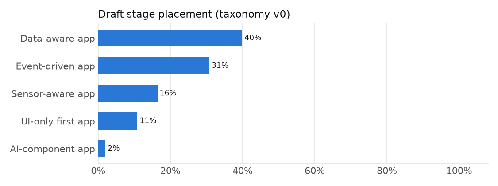

# Adaptive Pathways — data report

_Generated by `python run_pipeline.py report`. All numbers below are recomputed from `data/` on every run._

## 1. Corpus

| source | total | in_analysis |
|---|---|---|
| github | 374 | 371 |
| official | 14 | 14 |
| gallery | 12 | 11 |

* Projects stored: **400**; used in analysis: **396**
  (excluded: 3 structural near-duplicates, 1 empty, 0 parse errors).
* Downloads rejected before storage: `{'not_zip': 2, 'too_large': 1}`
  (`not_app_inventor` = other software's `.aia` files, e.g. Adobe Illustrator actions).
* Licences (top): `{'MIT': 253, 'GPL-3.0': 66, 'Apache-2.0': 21, 'CC0-1.0': 18, 'CC BY-SA 4.0 (MIT App Inventor)': 14, 'CC BY-SA 4.0 (App Inventor Gallery terms)': 12, 'Unlicense': 4, 'GPL-2.0': 4, 'BSD-2-Clause': 2, 'CC-BY-4.0': 1}`

## 2. Parser quality

* aiatools parsed **98.5%** of projects; the rest used the direct XML/JSON reader.
* Agreement between aiatools and the direct reader: blocks **99.7%**,
  components **99.2%**.
* 6 projects use the pre-2013 block format (`Button1_Click`); they are normalised to the modern vocabulary.
* Known aiatools issue handled: project-level `AIAFile.blocks()` returns only one screen's blocks in multi-screen
  projects; the pipeline aggregates `screen.blocks()` per screen instead.

## 3. Comparison with the published Gallery baseline

| metric | this corpus | Gresse von Wangenheim et al. |
|---|---|---|
| mean_blocks | 261.551 | 162.500 |
| pct_under_15_blocks | 0.144 | 0.250 |
| pct_with_events | 0.967 | 0.900 |
| pct_with_loops | 0.172 | 0.060 |
| pct_with_button_or_label | 0.960 | 0.850 |

Differences are expected: this corpus over-samples curated sources (official tutorials, featured Gallery apps,
GitHub repositories), so it skews larger and more structured than the full Gallery.

## 4. Clustering (RQ1)

Primary solution: **kproto, k = 3** (silhouette 0.133,
stability ARI 0.989) — rule: max silhouette over (method, k) with stability ARI >= 0.6 and min cluster size >= 3.

Silhouette values around 0.1 indicate overlapping rather than sharply separated groups: learner projects form a
continuum, which is consistent with treating stages as a progression rather than discrete types.

| k | silhouette_hier | silhouette_kproto | kproto_seed_stability_ari | hier_bootstrap_stability_ari | hier_vs_kproto_ari | min_cluster_size_hier | min_cluster_size_kproto |
|---|---|---|---|---|---|---|---|
| 3 | 0.095 | 0.133 | 0.989 | 0.457 | 0.358 | 100 | 81 |
| 4 | 0.107 | 0.132 | 0.690 | 0.370 | 0.402 | 59 | 40 |
| 5 | 0.102 | 0.114 | 0.914 | 0.528 | 0.362 | 13 | 24 |
| 6 | 0.108 | 0.103 | 0.647 | 0.488 | 0.339 | 3 | 25 |
| 7 | 0.119 | 0.100 | 0.569 | 0.497 | 0.325 | 3 | 11 |
| 8 | 0.127 | 0.072 | 0.572 | 0.565 | 0.268 | 3 | 18 |
| 9 | 0.129 | 0.104 | 0.558 | 0.557 | 0.278 | 3 | 11 |

## 5. Draft stages vs. data-driven clusters

ARI between the primary clusters and rule-based draft stages: **0.125**
(1 = identical partitions, 0 = chance). Low purity clusters are where the teacher review should focus.

| cluster | n | majority_stage | majority_stage_name | purity | stage_mix |
|---|---|---|---|---|---|
| 0 | 104 | 1 | UI-only first app | 0.413 | {"ui_first_app": 43, "event_driven": 35, "data_aware": 14, "sensor_aware": 11, "ai_component": 1} |
| 1 | 81 | 3 | Data-aware app | 0.741 | {"data_aware": 60, "sensor_aware": 14, "event_driven": 4, "ai_component": 3} |
| 2 | 211 | 3 | Data-aware app | 0.398 | {"data_aware": 84, "event_driven": 83, "sensor_aware": 40, "ai_component": 4} |

## 6. Next-step catalog

56 resources (13 with concepts measured from their own solution `.aia`).

## 7. Limitations

* Gallery listings are only partly reachable without login (featured apps); Gallery projects are collected
  only through public listings. GitHub repositories (open licences only) over-represent classroom and tutorial work.
* Stage labels are a rule-based draft (taxonomy v0) awaiting the two-teacher review in `taxonomy/stage_labels.yaml`.
* No telemetry, no learner outcomes: everything here is structural and descriptive.
